# RoadOS Visual Hazard Studio

**One visual language for every road.**

RoadOS Visual Hazard Studio is a web app that defines how road hazards look on screen: potholes, speed breakers, animals, flooding, road signs, traffic signals, work zones and more. It holds a catalogue of **267 road elements**, draws each one as a clean **SVG icon**, and gives every icon a **severity colour**, an optional **speed badge** and a **distance label**.

It is the first project in the **RoadOS graphics ecosystem** and starts with **Indian roads**. The icons, colours and data it exports are meant to be used by navigation apps, dashcams, driver-assist screens and a future RoadOS C++/Skia graphics SDK.

> The specification is called **RVHL 1.0** (RoadOS Visual Hazard Language). It is a RoadOS design proposal. It is **not** ISO-certified or officially approved by any government or standards body.

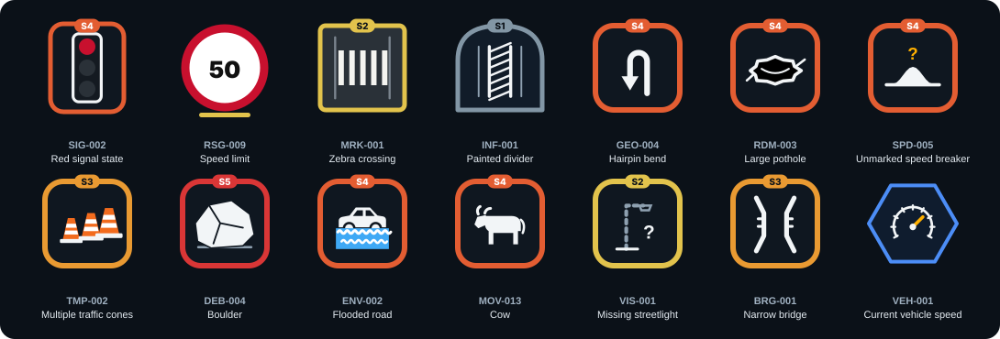

---

## Contents

- [Why this project exists](#why-this-project-exists)
- [Who can use it](#who-can-use-it)
- [Screenshots](#screenshots)
- [How the icons work](#how-the-icons-work)
- [Quick start](#quick-start)
- [How to use the app](#how-to-use-the-app)
- [How it is made](#how-it-is-made)
- [Project structure](#project-structure)
- [Standards and references](#standards-and-references)
- [Using the exported files](#using-the-exported-files)
- [Contributing](#contributing)
- [Limitations](#limitations)
- [License](#license)

---

## Why this project exists

Road signs are standardised, but many dangers on real roads are not: a deep pothole, an unmarked speed breaker, a cow on the highway, a fallen tree, a waterlogged underpass. Every app draws these differently, if it shows them at all.

This project creates **one consistent set of icons and rules** for both kinds:

| Kind | Examples | How it is drawn |
|---|---|---|
| **Standardised** signs and signals | Stop, speed limit, traffic signal | Keeps the official shape and colours of the convention |
| **Inspired by convention** | Variable message sign, toll barrier | Follows the usual convention style |
| **Non-standard hazards** | Pothole, debris, animals, flooding | RoadOS hazard tile with a severity colour |
| **RoadOS extensions** | Current vehicle speed, unknown limit | RoadOS instrument style |

Each catalogue entry records which kind it is, so official rules and RoadOS proposals are never mixed up.

## Who can use it

| Who | What they get |
|---|---|
| **Navigation and map app teams** | Ready-made hazard icons, alert cards and distance labels |
| **ADAS / dashcam / in-car display developers** | Icons that scale from small to large, plus a severity scale for alerts |
| **Road safety researchers and city teams** | A structured list of 267 road elements with detection methods and severity factors |
| **UI / UX designers** | Design tokens (colours, shapes, sizes) and editable SVG source drawings |
| **Graphics SDK engineers** | Simple SVG (no CSS, no clip paths) plus JSON data, ready to load in C++/Skia |
| **Students and learners** | A working example of a data-driven icon system built with React and TypeScript |

## Screenshots

**Dashboard**: overview of the catalogue, families and validation status.

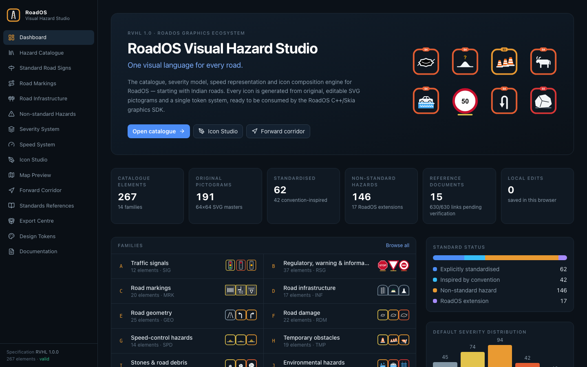

**Hazard catalogue**: search and filter all 267 elements.

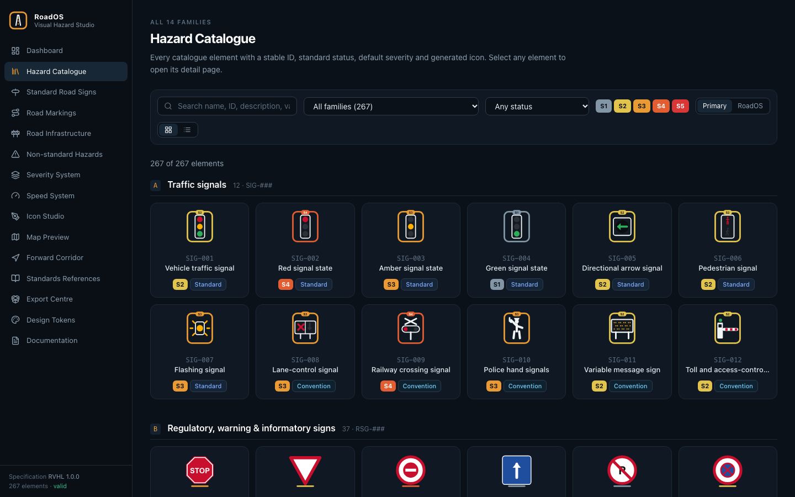

**Element detail page**: full data for one element, with an icon preview and a navigation-alert preview.

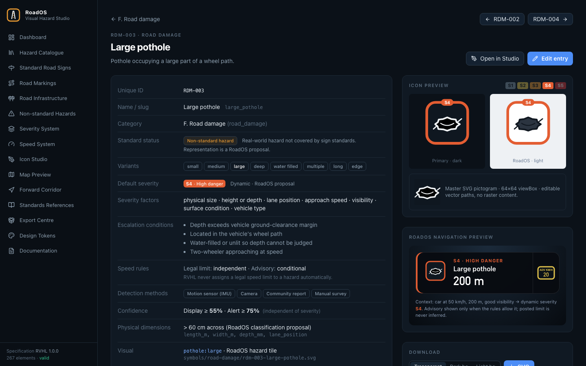

**Icon Studio**: build any icon with severity, speed, distance, direction and count, then copy or download the SVG.

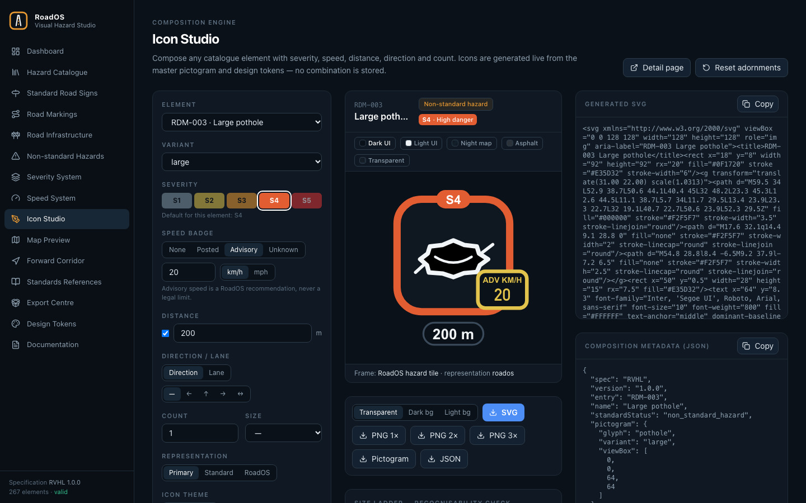

**Map preview**: hazards on a simulated route. No map API key needed.

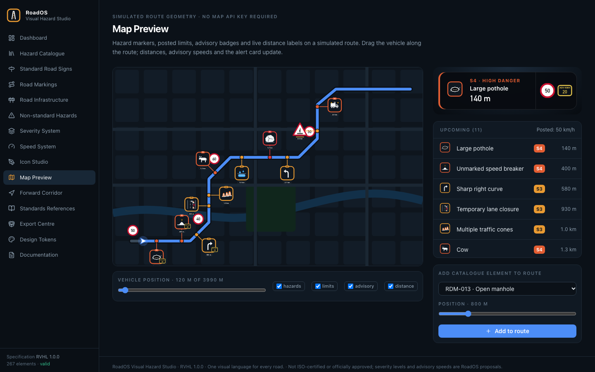

**Forward corridor**: a driver's-eye view of the road ahead, with hazards approaching.

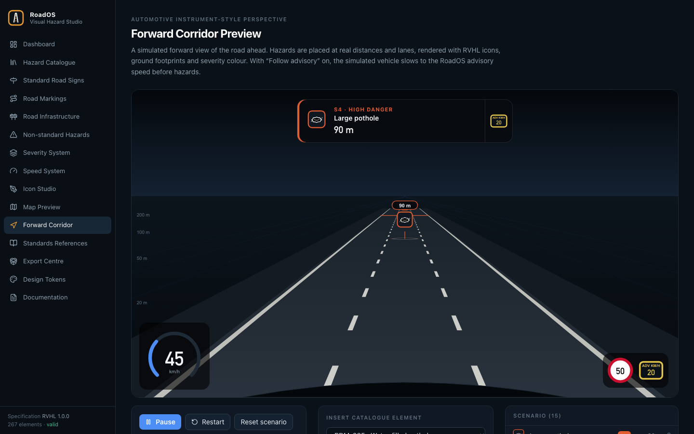

## How the icons work

### Built in layers

An icon is not stored as a finished picture. It is **built on demand** from one master pictogram plus layers:

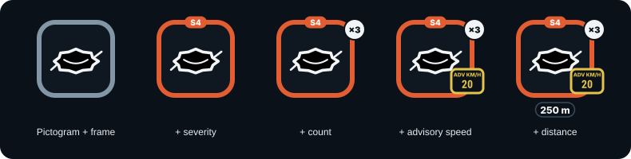

```
pictogram + frame + severity + size + count + speed badge + distance + direction
```

This keeps the asset set small. There is one master drawing per hazard, and every combination is generated from it.

### Severity scale S1 to S5

Severity means **how dangerous the hazard is right now**. It is shown by the colour of the frame. It is separate from **confidence** (how sure the system is that the hazard is really there).

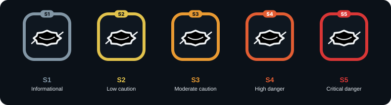

| Level | Meaning | Colour |
|---|---|---|
| S1 | Informational | `#8296A5` |
| S2 | Low caution | `#E2C34C` |
| S3 | Moderate caution | `#E99A32` |
| S4 | High danger | `#E35D32` |
| S5 | Critical danger | `#D93636` |

Severity can go up or down with conditions such as vehicle speed, visibility, night time, rain or lane position. The levels and the rules are **RoadOS proposals**.

### Three kinds of speed

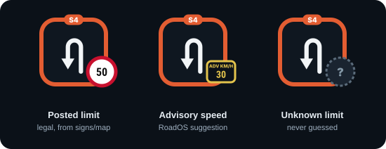

- **Posted limit** (red circle): the legal limit, taken from signs or map data.
- **Advisory speed** (yellow badge): a suggested safe speed calculated by RoadOS. It is **never** shown as a legal limit.
- **Unknown limit** (dashed circle): shown when the limit is not known. RoadOS never guesses a limit, and never adds a speed limit to a hazard automatically.

km/h is the default; mph is supported.

### Light and dark themes

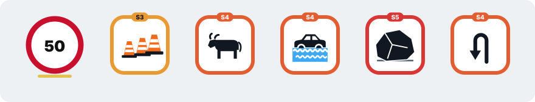

## Quick start

You need **Node.js 18 or newer** and **npm**.

```bash
git clone <your-repo-url>
cd visual-hazard-studio
npm install
npm run dev
```

Then open **http://localhost:5173** in your browser.

### All commands

| Command | What it does |
|---|---|
| `npm run dev` | Starts the app locally with live reload |
| `npm run build` | Type-checks and builds a static site into `dist/` |
| `npm run preview` | Serves the built `dist/` folder locally |
| `npm run typecheck` | Runs the TypeScript check only |
| `npm run validate` | Checks the whole catalogue: schema, unique IDs, every pictogram, and every icon variant rendered and checked for SVG errors |
| `npm run contact-sheet -- ./sheets [auto\|standard\|roados] [dark\|light]` | Draws all icons onto large SVG sheets for visual review |
| `npm run readme-images` | Regenerates the illustrations in `docs/images/` |

The built app uses hash routing (`/#/catalogue`), so `dist/` can be hosted anywhere: GitHub Pages, Netlify, Vercel, S3 or any static web server.

## How to use the app

| Section | What you can do |
|---|---|
| **Dashboard** | See totals, families, severity spread and validation status |
| **Hazard Catalogue** | Search by name, ID or keyword; filter by family, status or severity |
| **Standard Road Signs / Road Markings / Road Infrastructure / Non-standard Hazards** | Browse one group of the catalogue |
| **Element detail** | See all data for one element, edit it and download its icons |
| **Severity System** | Try the severity calculator: change speed, visibility, weather and see the result |
| **Speed System** | See how posted, advisory and current speed are displayed |
| **Icon Studio** | Build an icon and copy its SVG or download it as SVG or PNG |
| **Map Preview** | Move a vehicle along a route and watch distances and alerts update |
| **Forward Corridor Preview** | Drive towards hazards in a perspective road view |
| **Standards References** | See every reference document and its verification status |
| **Export Centre** | Download ZIP packs, catalogue JSON, tokens, manifests and docs |
| **Design Tokens** | See all colours, shapes, sizes and fonts |
| **Project Documentation** | Read the full RVHL specification |

**Editing:** open any element and click **Edit entry**. Changes are saved in your browser (`localStorage`) and included in exports. Use **Revert** to undo. To make a change permanent for everyone, edit the JSON files in `src/catalogue/data/` and open a pull request.

## How it is made

### Technology

| Part | Tool |
|---|---|
| UI | [React 18](https://react.dev/) + [TypeScript](https://www.typescriptlang.org/) |
| Build tool | [Vite](https://vite.dev/) |
| Styling | [Tailwind CSS v4](https://tailwindcss.com/) |
| App navigation icons | [Lucide](https://lucide.dev/) (UI only, not hazard icons) |
| Data validation | [Zod](https://zod.dev/) |
| ZIP export | [JSZip](https://stuk.github.io/jszip/) |
| Scripts | [tsx](https://tsx.is/) |

### Design principles

1. **Data first.** The catalogue is plain JSON. The app reads it, but it does not depend on the app, so it can be served from an API later.
2. **Original vector art.** All 191 pictograms are original drawings written as code on a 64×64 grid. No raster images are used as master assets, and no official sign artwork is copied.
3. **Icons are generated, not stored.** One function, `composeIcon()`, builds every icon variant from the master pictogram and the design tokens.
4. **Simple SVG for other platforms.** The SVG uses only explicit colours and basic shapes: no CSS, no `<clipPath>`, no ids, no external files. This makes it easy to render with Skia, Android, iOS or any other engine.
5. **Nothing is silently replaced.** If a pictogram is missing, the icon shows a labelled "PICTOGRAM PENDING" box, never an unrelated image.
6. **Honest references.** Clause, figure, page and sign numbers are left empty until someone checks them against the official document.
7. **Everything is validated.** `npm run validate` renders every icon variant (each element × theme × style × variant × severity) and checks it.

### How data flows

```
src/catalogue/data/*.json      (families + 14 family files + references)
           │
           ▼
buildCatalogue()               merges family defaults, checks schema, checks pictograms exist
           │
           ▼
CatalogueRepository            adds the user's browser edits (swappable for an API)
           │
           ▼
composeIcon()                  pictogram + tokens + options  →  SVG string
           │
           ├──▶ App pages (catalogue, studio, map, corridor …)
           └──▶ Export Centre (SVG, PNG, ZIP, JSON, manifests)
```

## Project structure

```
visual-hazard-studio/
├── docs/
│   ├── images/              README illustrations (generated by npm run readme-images)
│   └── screenshots/         App screenshots
├── public/                  favicon
├── scripts/
│   ├── validate-catalogue.ts   Full catalogue + icon validation
│   ├── contact-sheet.ts        Visual review sheets
│   └── readme-images.ts        README illustrations
└── src/
    ├── catalogue/
    │   ├── data/            families.json, references.json, a-…json to n-…json (267 elements)
    │   ├── schema.ts        Zod schema for every field
    │   └── build.ts         Builds the catalogue from the JSON files
    ├── icons/
    │   ├── glyphs/          191 original SVG pictograms (as code)
    │   └── compose.ts       Icon composition engine
    ├── engine/              Severity calculator, advisory speed, route geometry
    ├── tokens/tokens.json   Design tokens (colours, shapes, sizes, fonts, themes)
    ├── export/              SVG/PNG download, ZIP bundles, manifests
    ├── state/               Catalogue repository and browser edits
    ├── components/          Shared UI components
    ├── pages/               The 15 app sections + element detail page
    └── docs/rvhl-spec.md    Full RVHL specification
```

### The 14 families

| Letter | ID prefix | Family | Count |
|---|---|---|---|
| A | `SIG` | Traffic signals | 12 |
| B | `RSG` | Regulatory, warning & informatory signs | 37 |
| C | `MRK` | Road markings | 20 |
| D | `INF` | Road infrastructure | 17 |
| E | `GEO` | Road geometry | 25 |
| F | `RDM` | Road damage | 22 |
| G | `SPD` | Speed-control hazards | 14 |
| H | `TMP` | Temporary obstacles | 19 |
| I | `DEB` | Stones & road debris | 20 |
| J | `ENV` | Environmental hazards | 19 |
| K | `MOV` | Moving hazards | 25 |
| L | `VIS` | Visibility & roadside hazards | 15 |
| M | `BRG` | Bridge & special structures | 14 |
| N | `VEH` | Vehicle context | 8 |
| | | **Total** | **267** |

Every element has a stable ID such as `RDM-003` (Large pothole). IDs never change, so other systems can rely on them.

## Standards and references

The catalogue links each element to the documents below. They are listed to show **where the conventions come from**. RVHL does not reproduce their content or artwork.

> **Verification policy.** No clause, figure, page or sign numbers are given in this project. Every element-to-document link is marked **"Reference pending verification"** until an editor checks it against the official text and records who checked it and when. Several documents are paid publications; the links below go to the publisher's website, not to the document itself.

### International

| Document | Publisher | Link |
|---|---|---|
| Vienna Convention on Road Signs and Signals, 1968 | United Nations | [UN Treaty Collection](https://treaties.un.org/Pages/ViewDetailsIII.aspx?src=TREATY&mtdsg_no=XI-B-20&chapter=11&Temp=mtdsg3&clang=_en) |
| MUTCD, 11th Edition (Manual on Uniform Traffic Control Devices) | U.S. Federal Highway Administration | [mutcd.fhwa.dot.gov](https://mutcd.fhwa.dot.gov/) |
| ISO 2575: Road vehicles, symbols for controls, indicators and tell-tales | ISO | [iso.org](https://www.iso.org/) |
| ISO 15008: Road vehicles, in-vehicle visual presentation | ISO | [iso.org](https://www.iso.org/) |
| ISO 3864: Graphical symbols, safety colours and safety signs | ISO | [iso.org](https://www.iso.org/) |
| ISO 9241-112: Ergonomics, principles for the presentation of information | ISO | [iso.org](https://www.iso.org/) |

### India

| Document | Publisher | Link |
|---|---|---|
| IRC:67, Code of Practice for Road Signs | Indian Roads Congress | [irc.nic.in](https://www.irc.nic.in/) |
| IRC:SP:55, Traffic Management in Work Zones | Indian Roads Congress | [irc.nic.in](https://www.irc.nic.in/) |
| IRC:119, Traffic Safety Barriers | Indian Roads Congress | [irc.nic.in](https://www.irc.nic.in/) |
| IRC:103, Pedestrian Facilities | Indian Roads Congress | [irc.nic.in](https://www.irc.nic.in/) |
| IRC:99, Traffic Calming Measures | Indian Roads Congress | [irc.nic.in](https://www.irc.nic.in/) |
| IRC:SP:88, Manual on Road Safety Audit | Indian Roads Congress | [irc.nic.in](https://www.irc.nic.in/) |
| IRC:82, Maintenance of Bituminous Road Surfaces | Indian Roads Congress | [irc.nic.in](https://www.irc.nic.in/) |
| Motor Vehicles (Driving) Regulations, 2017 | Ministry of Road Transport and Highways | [morth.nic.in](https://morth.nic.in/) |
| MoRTH Specifications for Road and Bridge Works | Ministry of Road Transport and Highways | [morth.nic.in](https://morth.nic.in/) |

The full list, with scope and licensing notes, is in [`src/catalogue/data/references.json`](src/catalogue/data/references.json) and on the **Standards References** page in the app.

**What is official and what is a RoadOS proposal:**

- **Taken from conventions:** sign shapes and colour families for standardised signs (for example, a red circle for prohibitions and a triangle for warnings).
- **RoadOS proposals:** the S1–S5 severity scale and its colours, the severity rules, the advisory speed values, the hazard tile design, the size classes for potholes and stones, and all non-standard hazard pictograms.

## Using the exported files

The **Export Centre** creates:

| Export | Contents |
|---|---|
| Single icon | SVG, or PNG at 1× / 2× / 3× (64 / 128 / 192 px), with a transparent, dark or light background |
| ZIP pack | All icons, one family, or every severity level, with a manifest |
| `catalogue.json` | All 267 elements with their full data |
| `tokens.json` | Colours, shapes, strokes, sizes, fonts and themes |
| SVG manifest | File list with IDs and checksums |
| Reference manifest | All documents and the verification status of each link |
| Documentation | The RVHL specification as Markdown |

File names are stable, for example `symbols/road-damage/rdm-003-large-pothole.svg`, so other projects can depend on them.

## Contributing

1. Fork the repository and create a branch.
2. Edit the catalogue in `src/catalogue/data/`, or pictograms in `src/icons/glyphs/`.
3. Run `npm run validate` and `npm run build`. Both must pass.
4. Run `npm run contact-sheet -- ./sheets` and look at your icons in both themes.
5. Open a pull request.

**Rules for references:** do not add clause, figure, page or sign numbers unless you have checked them in the official document. Record who checked and when (`verifiedBy`, `verifiedOn`). If you are not sure, leave the link as *pending*.

**Rules for artwork:** draw original pictograms. Do not copy artwork from standards documents or other icon sets.

## Limitations

- All references are still **pending verification**.
- Some pictograms would benefit from a designer's review (for example the generic animal, animal carcass, collision and vehicle breakdown icons).
- Browser edits are stored only in the current browser. There is no shared backend yet.
- ZIP packs that include PNGs are drawn in the browser one by one, so they are slow for the full catalogue.
- Map and corridor views use simulated roads, not real map data.

## Roadmap

- Verify references against the official documents.
- Add a shared backend API in place of browser storage.
- Release the **RoadOS C++/Skia graphics SDK**, which will use `tokens.json`, the SVG assets and `catalogue.json` from this project.
- Add more regions beyond India.

## License

No license has been chosen yet. Until a `LICENSE` file is added, all rights are reserved by the project owner.

Referenced standards belong to their publishers. RVHL artwork is original and does not reproduce official figures.

---

*RoadOS Visual Hazard Studio · RVHL 1.0.0 · One visual language for every road.*
